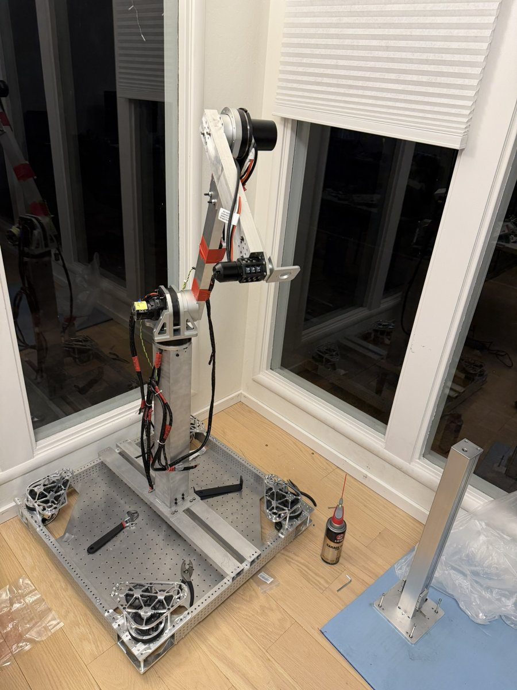
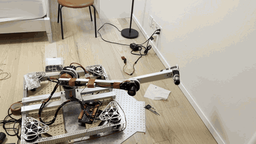
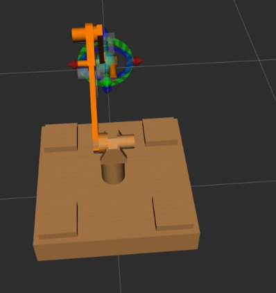
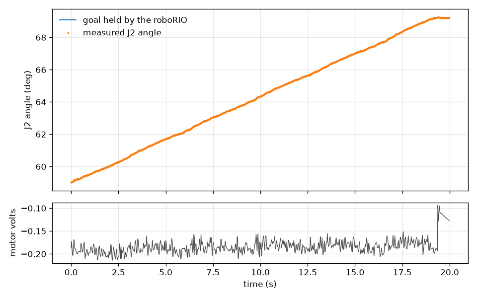

# EverFrame robot arm

EverFrame is my own mobile robot arm: a five-joint arm that positions a gripper, a lift column that sets its height, and a swerve-drive base that moves in any direction. I designed it in Fusion 360 and built it at home and in my school's shop; a machine shop made the metal joint parts from my STEP files. This repo holds the software side: the roboRIO code that drives the joints, the ROS/MoveIt setup on a Jetson that plans the arm's motion, the bridge between the two, the tools and one log I used to test it, and a small CAD script for a 1:4 scale lead arm.



*October 23, 2026: the arm on its base.*

## Demo



*December 30, 2025: J1, J2 and J3 moving together under power (a 9 s clip from my video).*

| December 31, 2025: my arm model in MoveIt | January 3, 2026: one J2 log (data/j2_trace_jerk.csv) |
|---|---|
|  |  |

Video: the EverFrame chapter of my MIT Maker Portfolio video (submitted with the portfolio; public link to be added).

## How it works

```
 MoveIt + MoveIt Servo (ROS Noetic, on the Jetson)
        |  joint trajectory (position, velocity, acceleration)
        v
 arm_nt4_bridge  (C++ node, 50 Hz loop)
        |  NetworkTables 4 over Ethernet:  Arm/J1..J3/RosPosRad, RosVelRadPerS, RosAccRadPerS2, RosSeq
        v
 roboRIO: TunableJoint x3  (Java / WPILib, every 20 ms)
        |  1. watchdog: if RosSeq stops changing for > RosTimeoutS, output 0 V
        |  2. clamp the target to the joint's soft limits
        |  3. volts = PI(position error) + kD*(velocity error)
        |            + kS*sign(v) + kG*cos(angle) + kV*v + kA*a,  limited to MaxVolts
        v
 SPARK Flex / SPARK MAX  ->  NEO Vortex / NEO motor  ->  100:1 reducer  ->  joint
        |
        +-- measured angle goes back over NetworkTables -> /joint_states in ROS
```

Every joint also has a manual target mode and a sine-wave test mode that runs on the roboRIO itself, so I could compare "motion made on the roboRIO" with "the same motion streamed from ROS". All gains and limits are NetworkTables values, so I tuned them live from a laptop. Notes from development on the control modes and NetworkTables keys (in Chinese) are in `docs/notes_zh/`.

## Build and run

### Hardware

- roboRIO (FRC control system) with CAN wiring
- J1 and J2: SPARK Flex + NEO Vortex, 100:1 harmonic reducer (CAN IDs 2 and 3)
- J3: SPARK MAX + NEO, 100:1 harmonic reducer (CAN ID 4)
- NVIDIA Jetson running ROS Noetic (I ran it in a Docker container), on the same network as the roboRIO
- The roboRIO address in the code is `10.1.14.2` (team number 114); change `server_ip` for another team number.

### roboRIO code (`roborio/`)

Needs JDK 17 (the WPILib 2025 installer includes it; JDK 21 also worked for me).

```bash
cd roborio
./gradlew build            # compile (downloads WPILib 2025 and REVLib)
./gradlew simulateJava     # run the robot program in the WPILib desktop simulator
./gradlew deploy           # put it on the roboRIO (needs the robot connected)
```

### ROS workspace (`ros/`)

Needs Ubuntu 20.04 + ROS Noetic. The NT4 bridge uses C++20, so build with g++-10. Its CMake downloads the WPILib ntcore libraries for linux-arm64 (Jetson).

```bash
cd ros
sudo apt install g++-10
rosdep install --from-paths src --ignore-src -y
catkin_make -DCMAKE_C_COMPILER=gcc-10 -DCMAKE_CXX_COMPILER=g++-10
source devel/setup.bash

# arm model and planner only, no hardware
roslaunch robotics_arm_moveit_config demo.launch

# real arm: MoveIt Servo -> NT4 bridge -> roboRIO
CATKIN_WS=$PWD roslaunch arm_nt4_bridge moveit_servo_to_nt4.launch server_ip:=10.1.14.2
```

### Test tools and data

```bash
# watch one joint over NT4 at 50 Hz and save a CSV (needs the robot or the simulator)
uv run --with pyntcore python roborio/tools/nt/nt4_watch_arm.py --server 10.1.14.2 --joint J2 --dur 20 --hz 50 --csv j2.csv

# redraw the J2 plot above from the saved log
uv run --with matplotlib python data/plot_j2_trace.py
```

### Lead-arm CAD helper (`cad/lead_arm/`)

Reads the arm's URDF and writes a STEP file with one circle per joint axis (full size and 1:4), as a skeleton for a small lead arm. `onshape/arm_joint_axes.fs` is the same idea as an Onshape FeatureScript.

```bash
cd cad/lead_arm
uv run gen_joint_axes_step.py
```

Checked on Nov 1, 2026, while preparing this snapshot with Claude Code: `./gradlew build` passes and `./gradlew simulateJava` starts the robot program (macOS); `catkin_make` passes in an arm64 `ros:noetic-ros-base` Docker container with g++-10; the URDF parses with `xacro` + `check_urdf`; the lead-arm script regenerates both STEP files; the plot script runs. The hardware steps were run on the real arm in December 2025 and January 2026, not again for this repo.

## Repo layout

```
roborio/                   WPILib Java project for the roboRIO
  src/main/java/frc/robot/
    subsystems/TunableJoint.java   one joint: modes, watchdog, PID + feedforward, telemetry
    subsystems/ArmSubsystem.java   creates J1-J3 and the shared Arm/ table
    util/SineGoalGenerator.java    sine test motion
  tools/nt/                Python NT4 tools: watch/log, go-to, rate check, sine from the laptop
ros/src/
  robotics_arm_urdf/       URDF + meshes exported from my Fusion 360 model (fusion2urdf)
  robotics_arm_moveit_config/  MoveIt config (made with MoveIt Setup Assistant)
  arm_nt4_bridge/          C++ bridge: MoveIt Servo -> NT4, NT4 angles -> /joint_states
  arm_nt_bridge/           Python bridges (planned trajectory, interactive marker, joint jog)
  arm_control/             ros_control hardware node and launch files
ros/tools/                 start/stop and test scripts for the Docker setup, log-to-HTML parser
cad/lead_arm/              joint-axis STEP generator, FeatureScript, generated STEP files
data/                      one 20 s J2 log (Jan 3, 2026) and its plot script
docs/notes_zh/             control and NetworkTables notes from development (Chinese)
media/                     pictures used in this README
```

This is a cleaned-up snapshot. The full history is in my private repos `frc2026` (folder `new/JerryRoboticsArm2`, Dec 2025 to Jan 2026) and `catkin_ws` (the Jetson workspace). The main Fusion 360 assembly is not in this repo.

## Results and limits

- J1, J2 and J3 moved together under power (December 30, 2025, video above). By January 3, 2026, MoveIt on the Jetson was streaming their targets to the roboRIO; the log in `data/` was recorded in that mode.
- The arm jerked between positions when targets were streamed from ROS. A sine wave generated on the roboRIO was smooth; the same motion streamed from my computer was jerky. Changing the update rate and filtering did not fully fix it. The log in `data/` is one of the files I recorded while chasing this: in that slow 20 s move, J2 stayed within 0.04 degrees of its goal, but the log has gaps of up to 70 ms between samples.
- The joints use the motors' built-in relative encoders, so J2 loses its zero after power-off. I reset it with a digital angle gauge.
- Output is limited to 2 V by default (`MaxVolts`) for safety during testing.
- J4, J5, the gripper and the lift column are not in this control code. The lift is untested.
- `arm_hw_node` in `ros/src/arm_control` has no hardware I/O of its own; the real arm is driven through `arm_nt4_bridge`.

## Credits

**My work (Jerry Wu):** the idea and the whole arm design (joint layout, reducer and motor choices, CAD), building and wiring it, the control approach (ROS/MoveIt plans on the Jetson, the roboRIO tracks the targets with PID plus feedforward and a watchdog), every hardware test, tuning the gains, and the jerk investigation and its test plan.

**Code written by AI:** Cursor wrote most of the code in `roborio/` and `ros/` from my requirements; I tested it on the arm and tuned it. The lead-arm STEP script and FeatureScript in `cad/lead_arm/` were written with an AI coding assistant from my description. Claude Code assembled this snapshot, wrote this README and `data/plot_j2_trace.py`, and made the GIF and plot from my video and log.

**Open-source and other people's work:**
- [WPILib](https://github.com/wpilibsuite/allwpilib) (BSD, see `roborio/WPILib-License.md`): robot framework, project template and NetworkTables (ntcore).
- REVLib (REV Robotics): SPARK motor controller library, downloaded at build time.
- [MoveIt](https://moveit.ros.org/) and MoveIt Servo (BSD): motion planning; `robotics_arm_moveit_config` was generated with the MoveIt Setup Assistant and then edited.
- [ROS Noetic](https://www.ros.org/) and ros_control.
- [fusion2urdf](https://github.com/syuntoku14/fusion2urdf) by Toshinori Kitamura (MIT, see `ros/src/robotics_arm_urdf/LICENSE` and `cad/lead_arm/arm_description/LICENSE`): exported my Fusion 360 model to URDF.
- [build123d](https://github.com/gumyr/build123d) (Apache-2.0): STEP export in the lead-arm script.
- Gradle wrapper (Apache-2.0) in `roborio/gradle/`.
- A machine shop machined the aluminum joint parts from my STEP files.
- No teammate code is in this repo. The arm's purchased parts (harmonic reducers, REV motors and controllers, swerve modules, lift module) and their vendor CAD are not included.
