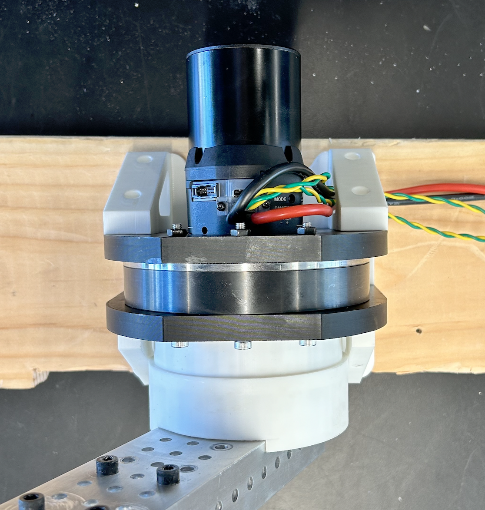
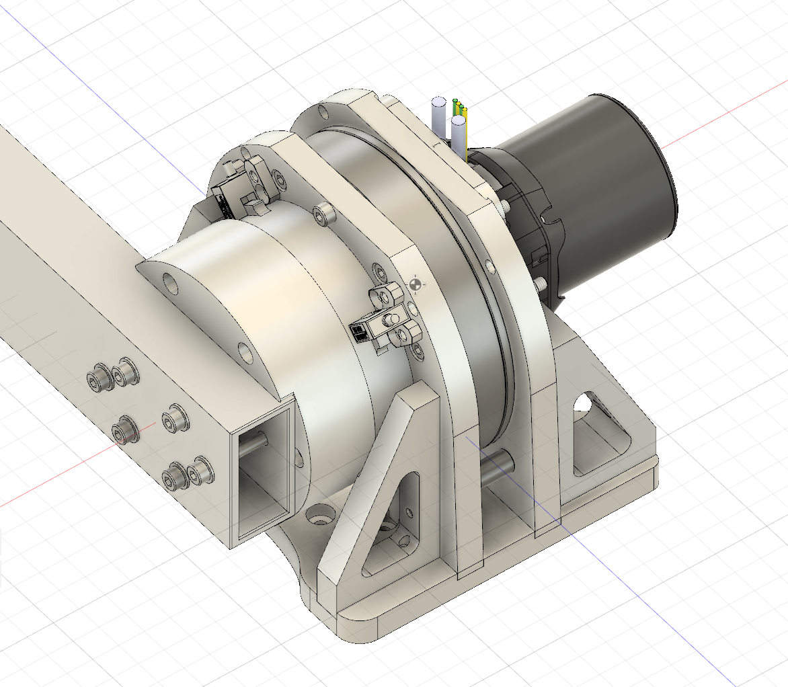
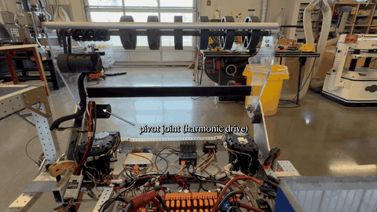
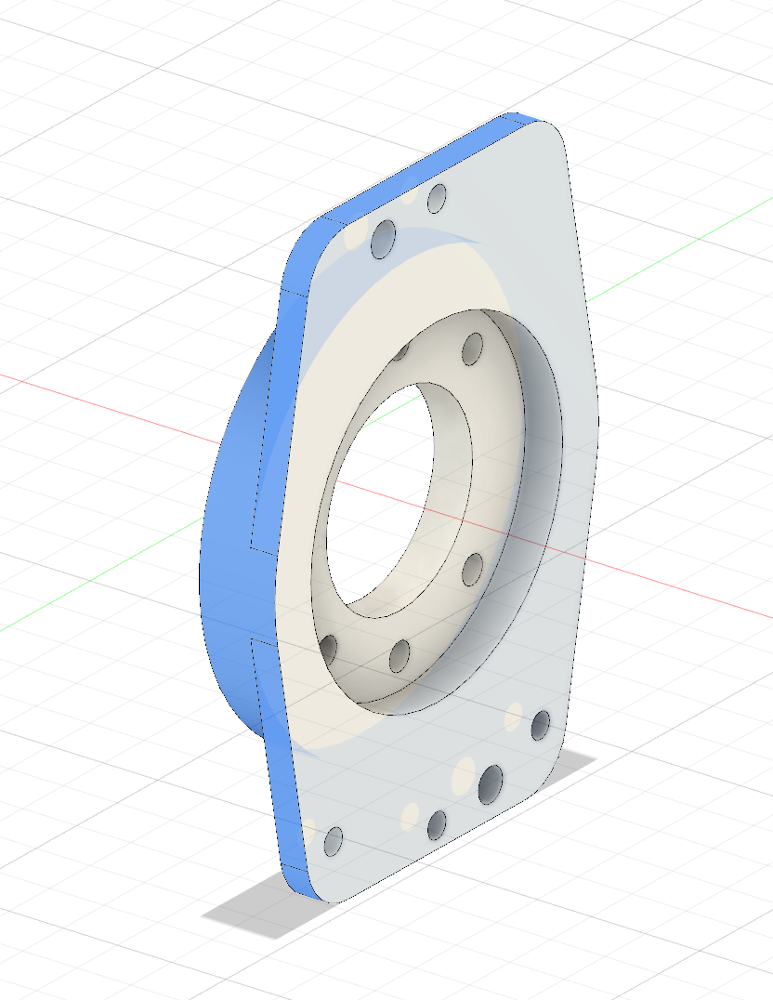
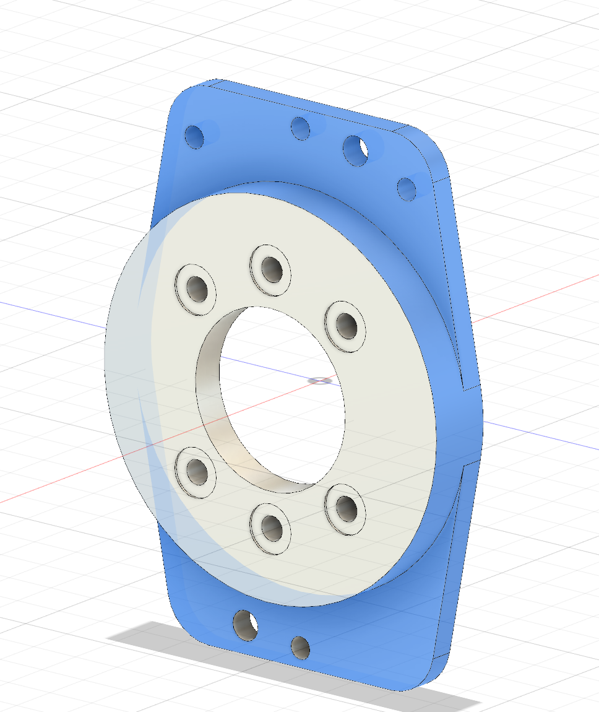
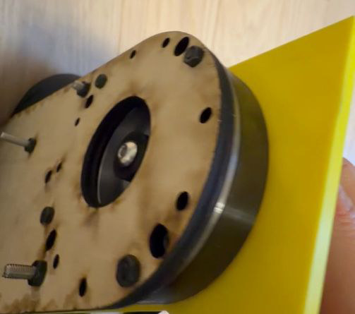
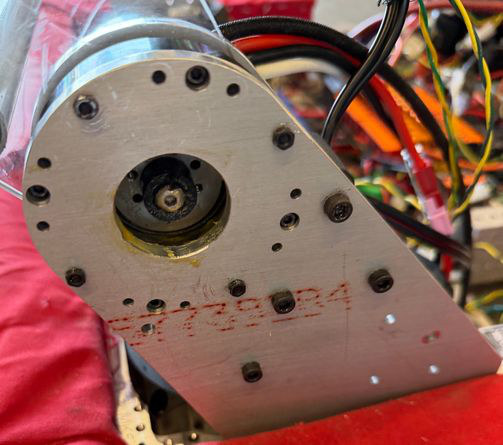
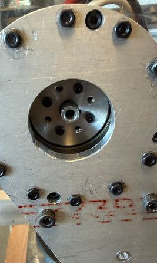

# Harmonic-Drive Joint CAD

*This folder was the repository `harmonic-drive-joints`; it was merged into `everframe-robot-arm` on Nov 1, 2026, with its history. Paths below are relative to this folder.*

CAD for the harmonic-drive robot joints I designed: motor-side **adapters** and output-side **joints** that bolt together through one fixed interface, so I can change the motor or the joint without redrawing the other side. The D25 vertical joint in this repo is joint J2 (and J1) of my EverFrame robot arm: a 100:1 D25 harmonic reducer driven by a REV NEO Vortex. I sorted the parts into this library in September 2025, while I was on FRC Team 114. In 2026 I used a harmonic reducer again, on the team's intake pivot (see below); that pivot was drawn separately in the team's CAD and is not part of this library.

<p align="center">
  
  
</p>
<p align="center"><i>Left: the built D25 joint, Sep 2025. Right: the same joint in CAD (Fusion 360).</i></p>

## Demo

| Arm joint J2 (Sep 2, 2025) | FRC 114 intake pivot (Feb 7, 2026) |
|---|---|
|  |  |
| J2, built from this design, lifted a bag on a long rod to about 70° on Sep 2, 2025 (video not stored in this repo). | The harmonic-drive intake pivot moving the intake down and up on the team's robot during the one-hour test. Sped up. |

Clips from both are in my MIT Maker Portfolio video (EverFrame arm and FRC 114 chapters). Raw videos are not stored in this repo.

## How it works

```
 motor (NEO Vortex / Kraken X60)
   |  motor plate + shaft sleeve        <- ADAPTER (motor side)
   v
 harmonic reducer (D25, 100:1)
   |  fixed bolt pattern and pilot      <- the shared interface ("AJI")
   v
 output plates, gussets, arm mount      <- JOINT (output side)
   |
   v
 arm link / tube
```

- **Adapter**: holds one motor model on the reducer input. Each motor gets its own adapter.
- **Joint**: connects the reducer output to the rest of the mechanism.
- **Interface (AJI, "adapter-joint interface")**: the pilot, bolt circle, hole size and count, and face thickness are kept the same for every adapter and joint of one reducer size. The fixed area is shown in blue on the reference adapter below. Parts only mate within one size (D25 with D25).

<p align="center">
  
  
</p>
<p align="center"><i>The D25 reference adapter. Blue = the fixed interface that every D25 adapter and joint keeps.</i></p>

## What is in this repo

```
mechanical/
  adapters/D25/
    D25-NEOVertex-v5-P.step     # adapter for the REV NEO Vortex (+ SPARK Flex); this is the one I built
    D25-KrakenX60-v1-NT.step    # adapter for the Kraken X60 (CAD only)
  joints/
    D25-vertical.step           # the J1/J2 joint of my arm, with motor, reducer and output plates
docs/
  design-example/
    D25-MotorBoardAdapter_example-design_reference.step   # reference adapter: the interface to design against
    pictures/                   # CAD views
  real-pictures/                # photo of the built joint
  demo/                         # the two GIFs above
  frc114-intake-pivot/          # photos of the intake pivot
tools/
  step_info.py                  # lists the header and every part name inside a STEP file
LICENSE                         # CERN-OHL-S-2.0
```

File names: `<reducer size>-<motor>-v<version>-<mount option>.step` for adapters, `<reducer size>-vertical.step` for joints. All files are STEP (mm, Z up). "NEOVertex" in the file names means the REV NEO Vortex.

## How to open and build it

**Open the CAD.** Any CAD program that reads STEP works (I used Fusion 360: *File > Open > Open from my computer*). The adapter and joint files are about 32 MB each because they include the vendor reducer, motor and controller models.

**See what is inside a file without CAD** (Python 3, no extra packages):

```bash
git clone https://github.com/OAK-WJR/everframe-robot-arm.git
cd everframe-robot-arm/cad/joints
python3 tools/step_info.py mechanical/joints/D25-vertical.step
python3 tools/step_info.py mechanical/adapters/D25/*.step
```

This prints the export time and every part name, which is also how you can tell my parts from vendor parts (see Credits).

**Hardware for the D25 + NEO Vortex joint** (what the CAD contains):
- D25 harmonic reducer, 100:1
- REV NEO Vortex (REV-21-1652) and SPARK Flex (REV-11-2159)
- 17 mm ID x 30 mm OD bearing, external retaining ring, M3 flat-head screws, 10-32 x 1/2" bolts for the motor
- my parts from the CAD: shaft sleeve (5 x 3.2 x 4 mm), shaft positioner (`ShaftPos8-24`), motor plate and output plates. I 3D-printed parts of the first J2; some later arm parts were machined from aluminum by an outside shop.

## FRC Team 114: harmonic-drive intake pivot (Jan–Feb 2026)

For the team's 2026 intake, I suggested a harmonic reducer for the pivot and designed its connection to the intake plate. I tested a wooden plate on the reducer first. A printed flange cracked at its shaft key and a replacement also failed, so I drilled mounting holes in a metal flange. In an hour-long pivot test on the team's robot, the structure held but the NEO motor overheated. The intake's hopper also got in the way of other mechanisms, so the team used a four-bar intake for competition. I also gave the team default control gains from my arm's harmonic-drive joint, which went into the team code's README on Jan 20, 2026.

<p align="center">
  
  
  
</p>
<p align="center"><i>Jan 18: wood test plate on the reducer. Jan 31: on the robot with a printed flange (black, center). Feb 6: the metal flange fitted.</i></p>

The pivot-plate CAD lives in the team's Onshape document and belongs to the team, and the robot code belongs to the team, so neither is in this repo.

## Results and limits

- **Built and working:** the D25 + NEO Vortex joint. On Sep 2, 2025 the J2 joint lifted a bag on a long rod to about 70° (GIF above), and the same design is used for J1 and J2 of my arm.
- **Fixed during the build:** the reducer sleeve was first drawn 5 x 3 x 4 mm and was too tight on the M3 screw, so I changed it to 5 x 3.2 x 4 mm. Both versions are still in the CAD.
- **CAD only:** the Kraken X60 adapter (no build record). I have not tested swapping adapters on real hardware, so "every D25 adapter fits every D25 joint" is a design rule, not a tested result.
- **Not made yet:** parallel (offset) joints and adapters for other reducer sizes.
- **Interface not dimensioned:** the fixed interface is defined by the reference adapter file and the blue area in its pictures; there is no drawing with tolerances.
- **The STEP files are not parametric.** Changing a size means editing the original Fusion 360 design.
- **Intake pivot:** the structure survived the one-hour test, but the motor overheated and the team did not use this intake in competition.

## Credits

**My work (Jerry / Jiarui Wu).** The idea to split each joint into a motor-side adapter and an output-side joint with one fixed interface; the CAD of my own parts in Fusion 360 (named `MotorBoard-*`, `D25-*`, `ShaftPos8-24`, the sleeves and spacers, and the `J1J2…` / `J2…` plates, gusset and arm mount in `D25-vertical.step`); the reference adapter; building and testing the J2 joint. For the intake pivot: suggesting the harmonic drive, designing its connection to the intake plate, the wood-plate test, drilling the metal flange and running the test.

**AI tools.** Claude Code (Nov 2026), at my request: rewrote this README from my notes and portfolio, removed vendor-only model files from this branch, wrote `tools/step_info.py`, and made the two GIFs from my videos. No AI tool drew the CAD. For the intake pivot, ChatGPT made a motor-sizing table (Jan 16, 2026) and gave a CAM warning (Jan 26, 2026).

**Vendor models and other people.**
- The assemblies include vendor CAD placed for fit, which belongs to its makers and is **not** covered by this repo's licence: the D25 harmonic reducer model from the reducer supplier; REV Robotics models (part numbers `REV-…`, including the NEO Vortex and SPARK Flex with their connector models); WCP models (`WCP-…`) for the Kraken X60; McMaster-Carr hardware models; and a catalog gusset model (`ZGB13-W40-H60-T10`) that my J2 gussets are based on. Bare vendor reducer models are not in this branch; get them from the supplier.
- FRC Team 114 built the team robot and the competition four-bar intake. Two teammates sketched an earlier gear-driven pivot, one teammate printed the second flange, and other teammates wrote and tuned the intake code.
- An outside machine shop machined some later aluminum arm plates from my STEP files.

## License

My own parts are licensed under **CERN-OHL-S-2.0** (see `LICENSE`). © 2025 Jiarui Wu. Vendor models inside the assemblies stay under their makers' terms.
